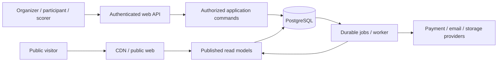

# 01 — Repository, deployment and code boundaries

[Engineering map](README.md) · Refines AT-01, AT-06, CW-04, EG-07

## E-ARCH-01 — One product, two runtime processes

Use one repository and one versioned release. Deploy a web process and a worker process against the same PostgreSQL database. Both import the same application modules. The browser never receives a database password, provider secret, privileged storage client or unrestricted query API.



Public websites use `/l/{leagueSlug}` initially. Authenticated surfaces use `/app/w/{workspaceId}/...`; the workspace ID in the URL is a requested scope, never evidence of membership. All authenticated pages live on the platform's canonical app origin. Later custom public domains resolve to a verified league/site record and link back to that app origin for login; do not distribute session cookies across customer domains.

Web instances are stateless between requests. Durable state is in PostgreSQL/object storage. Workers have bounded concurrency and persistent leases; adding a worker does not require adding a web instance. Avoid microservices, per-customer deployments, Kafka, Kubernetes, database sharding and a generic plugin marketplace in the first release. They require a concrete workload or isolation requirement plus an ADR before introduction.

## E-ARCH-02 — Package responsibilities

Use npm workspaces and a single lockfile, retaining the repository's Node 24 baseline pending the compatibility spike. Strict TypeScript applies to production code; the presentation example remains isolated. Choose one typed PostgreSQL query layer during the scaffold spike; recommended [Kysely](https://www.kysely.dev/docs/intro) over `pg`, with reviewed SQL migrations as schema authority. No ORM schema auto-sync in production.

| Directory / workspace package | Owns                                                                              | Must not contain                                                            |
| ----------------------------- | --------------------------------------------------------------------------------- | --------------------------------------------------------------------------- |
| `apps/web`                    | Next routes, server composition root, views, editor/scorer interaction            | Business rules duplicated from core; provider credentials in client imports |
| `apps/worker`                 | Worker startup, job dispatch, lease heartbeat, health endpoints                   | A second implementation of domain commands                                  |
| `packages/contracts`          | Zod request/response/config/event schemas and inferred types                      | DB access, environment reads, JSX, authorization decisions                  |
| `packages/core`               | Authorization-aware use cases, domain rules, ports, typed errors/events           | Next, React, provider SDKs, `pg`, arbitrary global service clients          |
| `packages/database`           | Typed SQL repositories, transactions, query DTOs, RLS context, generated DB types | UI, email/checkout network calls, shadow business workflows                 |
| `packages/providers`          | Auth/payment/email/storage adapters; provider payload translation                 | Independent capacity, standings or roster rules                             |
| `packages/sports`             | Sport definitions, deterministic reducers, rule validation, stat formulas         | HTTP, user identity, payment logic or database connections                  |
| `packages/ui`                 | Accessible primitives, tokens, table/form/error patterns                          | Tenant lookup, raw private objects or business write privileges             |
| `packages/site`               | Supported block registry, page renderer, public block data contracts              | Arbitrary HTML execution, private participant reads, SQL                    |
| `packages/observability`      | Typed log/redaction/metrics/trace helpers                                         | Raw request bodies, blanket exception dumps, credentials                    |
| `supabase/migrations`         | Ordered SQL DDL, constraints, grants, policies and SQL functions                  | Manual dashboard changes with no migration                                  |
| `tests`                       | Cross-package integration, browser, load and recovery evidence                    | Copies of implementation logic that merely confirm themselves               |
| `docs/architecture/decisions` | Accepted/proposed tradeoffs with consequences and revisit triggers                | Conflicting undocumented choices in feature branches                        |

The production topology is **2 app directories and 8 shared package directories**. Add packages only for a real ownership/dependency boundary. Each has its own `package.json`, `tsconfig.json`, `src/index.ts` and tests when used; do not create empty packages in advance.

## E-ARCH-03 — Concrete first-slice files

This is the initial inventory for verified organizer → workspace → league/competition → edited/public website. It names **40 application source files**, plus **5 first-slice verification files**. Package manifests, generated files, migrations and tool configuration are additional. This is a bounded first slice, not the eventual platform's total size.

```text
apps/web/src/
  app/layout.tsx
  app/(public)/l/[leagueSlug]/[[...pagePath]]/page.tsx
  app/(auth)/sign-in/page.tsx
  app/(auth)/auth/callback/route.ts
  app/(account)/app/page.tsx
  app/(account)/app/w/[workspaceId]/layout.tsx
  app/(account)/app/w/[workspaceId]/overview/page.tsx
  app/(account)/app/w/[workspaceId]/website/page.tsx
  app/api/v1/workspaces/route.ts
  app/api/v1/w/[workspaceId]/sites/[siteId]/draft/route.ts
  app/api/v1/w/[workspaceId]/sites/[siteId]/publish/route.ts
  features/website-editor/editor.tsx
  features/website-editor/block-inspector.tsx
  features/website-editor/page-preview.tsx
  server/container.ts
  server/request-context.ts
  server/respond.ts
apps/worker/src/
  main.ts
  dispatch.ts
  handlers/site-published.ts
packages/contracts/src/
  common.ts
  workspace.ts
  website.ts
packages/core/src/
  context.ts
  ports.ts
  modules/workspaces/create-workspace.ts
  modules/websites/save-draft.ts
  modules/websites/publish-site.ts
packages/database/src/
  transaction.ts
  repositories/workspaces.ts
  repositories/websites.ts
  queries/public-site.ts
packages/providers/src/
  auth/supabase.ts
packages/ui/src/
  button.tsx
  form-field.tsx
  tokens.css
packages/site/src/
  registry.ts
  render-page.tsx
  blocks/hero.tsx
packages/observability/src/
  logger.ts
tests/
  integration/workspace-isolation.test.ts
  integration/site-publication.test.ts
  integration/idempotency.test.ts
  browser/organizer-publish.spec.ts
  browser/editor-accessibility.spec.ts
```

Sport implementation enters with competition operations; the first setup slice can validate a registered basketball preset without building a live engine. More blocks and commands add files at the same boundaries. `page.tsx` composes views; `route.ts` validates transport and calls a use case; neither implements transactions. `container.ts` is the sole web wiring point for ports and adapters.

## E-ARCH-04 — Domain module map and internal layout

| Core module    | Owns commands / records                                                | External effects through ports                    |
| -------------- | ---------------------------------------------------------------------- | ------------------------------------------------- |
| `workspaces`   | Provisioning, plans/entitlements, league/season identity               | Billing subscription adapter, domain provisioning |
| `access`       | Invitations, role grants, scope checks, ownership transfer             | Auth identity verification, invitation delivery   |
| `people`       | Tenant person, account claims, guardianship, publication preferences   | Evidence storage, privacy processing              |
| `websites`     | Settings versions, site drafts/releases, navigation, page validation   | Asset metadata, public projection invalidation    |
| `registration` | Forms, applications, eligibility/admission, capacity/offers            | Payment order request, notifications              |
| `finance`      | Orders, attempts, refunds, reconciliation, SaaS/participant separation | Payment adapter                                   |
| `rosters`      | Teams, entries, effective roster memberships, drafts                   | Publication events                                |
| `competition`  | Stages, supported formats, qualification, rules versions               | Schedule requests, result publication             |
| `scheduling`   | Resources, proposals, bookings, revisions                              | Generation jobs, notices/calendar feeds           |
| `games`        | Game state, scoring lease/events, lineup stints, result versions       | Sport engine, projection requests                 |
| `statistics`   | Standings/player read models, coverage, rebuilds                       | Sport formulas, versioned public records          |
| `engagement`   | Inbox, subscriptions, announcements and delivery intents               | Email adapter                                     |
| `media`        | Assets, quarantine, derivative/publication lifecycle, video links      | Storage/scanner/transformer                       |
| `awards`       | Definitions, criteria, grants and public cabinets                      | Result subscriptions, media lookup                |
| `integrations` | Imports, ID maps, scoped API clients, outbound deliveries              | Provider-specific adapters                        |

Within a module, use `commands/<verb>.ts`, `queries/<view>.ts` only for application-level query orchestration, `rules/`, `policy.ts`, `events.ts`, `ports.ts`, and `index.ts` as needed. Pure tests sit beside rules; integration tests use real database policies. A small module starts with a few named files, not seven empty folders. Split a command when input handling, domain calculation and persistence have separate responsibilities. Review files over roughly 300 non-generated lines for cohesion; do not enforce line count as a correctness rule.

Cross-module writes go through the owning module's exported use case/port, or a named orchestration command owning one transaction. Example: draft selection invokes roster placement inside the same transaction as the pick. It must not call an internal HTTP endpoint or dispatch an eventual job for the atomic roster mutation. Cross-module events handle effects that can safely occur after commit, such as email.

## E-ARCH-05 — Import and contract rules enforced by CI

Dependency direction:

```text
contracts <- sports
contracts + sports <- core
contracts + core ports <- database / providers
contracts + ui <- site
core + adapters + ui/site <- apps (composition roots)
observability <- adapter/app instrumentation
```

`core` may use an injected logging port, not a provider logger. `packages/site` receives public DTOs; its components do not fetch arbitrary URLs. The dependency graph must be acyclic. Package `exports` expose only public entry points; ESLint restricted imports and a dependency graph check prohibit deep imports into another module's internals. Mark server adapters `server-only` in the web integration; verify client bundles contain no `pg`, secret environment variable references or server entry points.

Enable `strict`, `noUncheckedIndexedAccess`, `exactOptionalPropertyTypes`, `noImplicitOverride` and checked error handling. No blanket `any`, ignored type errors or lint suppression without a narrow documented reason. Validate untrusted input at runtime; TypeScript alone does not validate HTTP/provider/JSONB data. Generate public API documentation from the same contract definitions used by handlers and CI-check drift.

Use explicit public response DTOs rather than serializing ORM/database rows and deleting a few fields. A new private column must be absent from all public responses by default. Share types through contracts, not through frontend imports from server repositories.

Next.js distinguishes server and client component responsibilities. Our additional boundary is that public renderers receive approved data and every mutation reaches an authorized server command. [Next.js server and client components](https://nextjs.org/docs/app/getting-started/server-and-client-components).

## E-ARCH-06 — Representative use-case interface

```ts
type PublishSiteInput = {
  siteId: string;
  expectedDraftRevision: string;
  commandId: string;
};

type RequestContext = {
  accountId: string; // validated identity, never copied from request JSON
  workspaceId: string; // resolved and authorized on the server
  requestId: string;
  authenticatedAt: Date;
  assurance: 'aal1' | 'aal2';
};

type PublishSiteResult = {
  releaseId: string;
  releaseRevision: string;
  canonicalUrl: string;
};
```

`publishSite(context, input, dependencies)` owns permission, validation and transaction orchestration. Dependencies include a transaction runner, website repository, policy resolver, clock and ID generator. Tests inject a fixed clock/IDs; database integration tests use the real adapters. An injected clock helps test deadlines but server UTC is authoritative in production.

The web adapter handles cookies, request limits, CSRF, schema parsing and error formatting. The use case rechecks authoritative grants and revisions inside its transaction. The repository takes a transaction handle explicitly; no hidden independent connection halfway through a command. Provider network calls cannot run inside this transaction.

## E-ARCH-07 — Evolution and reuse

Store migrations in timestamp order with meaningful names. Deploy backward-compatible additions before code that requires them; remove old fields only after a measured compatibility window. A shared module upgrade includes config/data migration tests and a rollback or safe-disable path. Generated code is labeled and reproducible.

Customer branding is data, not a branch, package or stylesheet copied for each league. Templates contain supported configuration and sample content. Trophy differences belong in typed award definitions, criteria and cabinet blocks. Any new capability that cannot fit the current module contract requires an explicit product/architecture decision, not a hidden customer condition.

A future service extraction should move an existing boundary only after its transaction and delivery semantics are reconsidered. The monolith does not make remote transactions magically safe. Triggers to investigate extraction are separately measured saturation, stronger isolation requirements or a distinct team/release lifecycle—not the number of customers alone.
