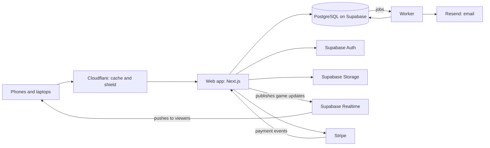

# T1 — Stack and architecture

[Spec home](../README.md) · Decisions T-1 to T-16

What the product is built from, how the pieces fit, and why. Written so a non-engineer can follow the reasoning and an engineer can start from it.

## 1. The choices at a glance

| Layer             | Choice                                                                                                         | In plain terms                                                                                                             |
| ----------------- | -------------------------------------------------------------------------------------------------------------- | -------------------------------------------------------------------------------------------------------------------------- |
| Language          | **TypeScript** everywhere, in strict mode. **SQL** for the database.                                           | One language for the browser, the server and background work                                                               |
| Web framework     | **Next.js** (App Router) with **React**                                                                        | Builds pages on the server so they load fast and search engines can read them, and runs interactive screens in the browser |
| Styling           | **Tailwind CSS**, with each league's design supplied as CSS variables. **shadcn/ui** components for the admin. | One set of building blocks; a league's colors and fonts are values, not separate stylesheets                               |
| Database          | **PostgreSQL**, hosted by **Supabase**. One database for all leagues.                                          | The standard database for structured, related data                                                                         |
| Database access   | **Kysely** (typed queries). Hand-written SQL migration files are the source of truth for the schema.           | The code cannot ask the database for a column that does not exist                                                          |
| Sign-in           | **Supabase Auth**: email and password, Google, and emailed codes                                               | We do not build our own login security                                                                                     |
| Files             | **Supabase Storage**, served from a separate web address                                                       | Logos and photos, kept apart from the pages for safety                                                                     |
| Live updates      | **Supabase Realtime** (broadcast), with timed re-fetching as fallback                                          | Pushes each scored basket to everyone watching                                                                             |
| Background work   | A separate **worker** process, with its job queue kept **in PostgreSQL** (pg-boss)                             | Reminders and recaps go out whether or not anyone has a page open                                                          |
| Email             | **Resend**, with templates written in React Email                                                              | A service whose whole job is getting email delivered                                                                       |
| Payments          | **Stripe**: Invoicing for what leagues pay us, Connect for leagues' fees, Checkout for card pages              | We never see or store a card number                                                                                        |
| Hosting           | Two containers built from one image, **web** and **worker**, on **Render**. **Cloudflare** in front.           | Two programs, one codebase, one database, with a shield and a cache in front                                               |
| Input checking    | **Zod** schemas shared by browser and server                                                                   | Every piece of incoming data is checked against a written shape                                                            |
| Tests             | **Vitest** for logic and database tests, **Playwright** for real-browser tests                                 | Already partly in use in this repository                                                                                   |
| Monitoring        | **Sentry** for errors, an uptime checker, structured logs                                                      | We hear about a problem before a customer tells us                                                                         |
| Build and release | **GitHub Actions**                                                                                             | Every change is tested automatically before it can go live                                                                 |

## 2. How the pieces fit

There are two programs of ours:

- The **web app** answers every request from a browser: public pages, the admin, the tracker.
- The **worker** does things on a timer or after an event: sending reminders a day before a game, sending recaps after a final, generating a schedule, running an import, cleaning up.

Both are the same codebase and talk to the same database. Neither keeps anything important in its own memory, so either can be restarted or copied to several machines without losing anything.

**T-1 (agreed, delegated): one application organized into modules, not many small services.** All the business rules live in one program with clear internal boundaries ([T2](T2-repo-and-code-structure.md)). Saving a game result and queuing its recap happen in one database transaction, which cannot half-succeed. Splitting into separate services would make that kind of guarantee much harder and would need operations work a small team cannot afford. We split something out only when a measured problem requires it.

## 3. Why each choice

**T-2: TypeScript.** The live tracker's rules run in the browser (for instant response and offline use) and on the server (as the authority). One language means that is one piece of code, not two that can drift apart. It is also the most widely used language for this kind of product, so help is easy to find.

**T-3: Next.js and React.** Public league pages must load fast on a phone in a gym and be readable by search engines, which favors building the page on the server. The admin, the site editor and the tracker are highly interactive, which favors React in the browser. Next.js does both in one project. The repository already contains a Next.js experiment (`apps/varsity-hosted`).

**T-4: PostgreSQL, and one database for everyone.** League data is relational through and through: players belong to teams, teams play games, games produce standings. PostgreSQL enforces those relationships and lets several changes succeed or fail together. A document database such as Firestore or MongoDB would make the first screen faster to build and every later feature (standings, statistics, moving a player) harder to get right.

One database with a `league_id` on every row, not a database per league. A thousand small leagues in a thousand databases is a thousand things to upgrade and back up. [T4](T4-tenancy-auth-security.md) covers how leagues are kept apart inside it.

**T-5: Supabase as the host for database, sign-in, files and live updates.** The founder already runs Faraj on Supabase. It gives us four needed services from one vendor at low cost, and the important part, PostgreSQL, is standard, so we can move to another host later without rewriting. We use Supabase as infrastructure only: the browser never talks to the database directly, as it does in Faraj today. Every read and write goes through our web app, where our rules live.

**The founder asked (November 12) whether security is easy with PostgreSQL, or whether something like Firebase would make it easier.** My answer is to stay with PostgreSQL on Supabase.

- Supabase gives the conveniences Firebase is known for (sign-in, file storage, live updates) on top of PostgreSQL. We give up none of them.
- Security is not easier in Firebase; it is done differently. There, the browser talks to the database directly, and safety depends on a file of access rules being exactly right. A mistake in those rules is the most common way such apps leak data. In our design the browser never talks to the database at all (T-64), so that whole kind of mistake is not available to us.
- PostgreSQL then adds protections that Firebase's database does not have. The database itself refuses a row that links two different leagues (T-40), refuses a second registration or a tap counted twice (T-47), and filters every query by league even if our code forgets to (T-61).
- Our data is relational (T-4), and PostgreSQL is a standard that every host offers, so we are never locked to one vendor.

**T-6: sign-in by Supabase Auth.** Password storage, emailed codes, Google sign-in, session cookies and rate limiting are solved problems we should not rebuild. Our own tables hold everything about what a person may do; the sign-in service only answers "who is this?".

**T-7: a worker with its queue in PostgreSQL.** Because jobs are rows in the same database as everything else, "the game was finalized" and "send its recap" are saved together. If the worker is down, jobs wait; when it returns, it continues. No separate queue product is needed at our size.

**T-8: Supabase Realtime for live game pages.** Each viewer holds an open connection to a service designed for holding many of them. Our web app sends one message per scored play; the service fans it out. If a viewer's connection fails, the page falls back to re-fetching the scoreboard every few seconds. The current tracker's own push mechanism works for one gym; this replaces it so that many games and thousands of viewers do not sit on our web servers.

**T-9: Render and Cloudflare.** Render runs containers with almost no setup, has separate "web service" and "background worker" types that match our two programs, and scales by adding copies. Railway and Fly.io are equivalent; price at build time can decide. Cloudflare sits in front for three reasons: it caches public pages near the visitor, it absorbs abusive traffic, and its "custom hostnames" feature is how leagues' own domains (U-2) get certificates later.

**T-10: Stripe.** The standard, and its Connect product is designed for exactly our situation: money goes to the league's account, we take a fee, and card details never touch our servers.

**T-11: Resend for email.** Simple, good delivery, and templates are written in the same React we already use. Postmark is the fallback choice if delivery quality disappoints.

## 4. What we deliberately do not use

| Not this                                                      | Because                                                                           |
| ------------------------------------------------------------- | --------------------------------------------------------------------------------- |
| Microservices, Kubernetes                                     | Operations cost with no benefit at our size (T-1)                                 |
| A database per league                                         | Unmanageable beyond a handful (T-4)                                               |
| A document (NoSQL) database as the main store                 | Our data is relational (T-4)                                                      |
| The browser reading the database directly                     | Rules would have to live in two places; one mistake exposes another league's data |
| GraphQL                                                       | Solves problems we do not have; adds a layer                                      |
| Our own login, email or card handling                         | High risk, no advantage                                                           |
| Per-league code, themes as code, plugins written by customers | B-3, U-1                                                                          |
| Native phone apps at launch                                   | See T-12                                                                          |

**T-12 (agreed, delegated): the website is the app.** It is built to work well on phones and can be added to the home screen, where it opens full-screen and the tracker works offline. This reaches every phone with one codebase and no app-store approval. We build native apps only if push notifications or app-store presence prove necessary for growth.

## 5. Following one action through

**A fan opens Faraj's standings.** Cloudflare has a recent copy and returns it immediately. If not, the web app reads the league's published page layout and its pre-calculated standings and builds the page. Cloudflare keeps the copy until a result changes it.

**A player opens the same page signed in.** The page itself is the same cached copy. The personal parts (the bell, "my next game", their team highlighted) are fetched separately with their session and added in. Personal data is never cached for others.

**A scorekeeper taps +2.** The tracker shows it at once and stores the tap on the device. It sends the tap to the web app, which checks the scorekeeper may score this game, applies it using the shared basketball rules, and saves the tap, the new score and the box score lines together. It then publishes the new scoreboard to Realtime. Viewers see it about a second later. If the send fails, the tracker retries; a tap can never be counted twice ([T6](T6-live-stats-and-realtime.md)).

**A game ends.** The same save also records "send recap in 10 minutes" as a job. The worker picks it up, builds each person's recap from current data, and hands the emails to Resend ([T7](T7-notifications-and-jobs.md)).

**An admin publishes a schedule change.** One transaction replaces the published schedule, writes the activity log, and queues notifications for affected people. Cloudflare's copies of the affected pages are cleared.

## 6. Environments

| Environment    | Purpose                                                                      | Data                         |
| -------------- | ---------------------------------------------------------------------------- | ---------------------------- |
| **Local**      | A developer's machine. The whole stack runs locally, including the database. | Made-up                      |
| **Preview**    | Created automatically for each proposed change, at its own address           | Made-up                      |
| **Staging**    | A full copy of production for rehearsing releases and load tests             | Made-up, at realistic volume |
| **Production** | The real thing                                                               | Real                         |

**T-13:** real people's data exists only in production. Nobody copies production data to another environment.

## 7. Not getting trapped

**T-14 (agreed, delegated): every outside service sits behind a small interface of our own.** The rest of the code says "send this email" or "publish this game update", not "call Resend" or "call Supabase Realtime". Replacing a vendor means rewriting one small adapter. The storage layer of the current tracker is already built this way.

The hardest thing to move would be the database, and PostgreSQL runs everywhere.

## 8. What it costs to run (estimates, to be verified at build time)

| Item                                      | Launch            | With around 100 leagues |
| ----------------------------------------- | ----------------- | ----------------------- |
| Supabase (database, sign-in, files, live) | about $25 a month | $25 to $100             |
| Render (web and worker)                   | about $15 to $50  | $50 to $150             |
| Cloudflare                                | $0 to $20         | $20                     |
| Resend                                    | $0 to $20         | $20 to $90              |
| Sentry and uptime checks                  | $0 to $30         | $30 to $60              |
| **Total**                                 | **under $150**    | **under $450**          |

These are from my knowledge of typical pricing, not quotes. Stripe has no monthly cost; it takes a share of each payment.

## 9. What happens to the code we already have

**T-15 (agreed, delegated):**

| Existing                                           | Becomes                                                                                                                                                                                         |
| -------------------------------------------------- | ----------------------------------------------------------------------------------------------------------------------------------------------------------------------------------------------- |
| `packages/sports` (basketball rules, tested)       | Stays, unchanged in role. The platform's game module calls it.                                                                                                                                  |
| `packages/contracts`                               | Stays and grows to cover every module                                                                                                                                                           |
| `apps/live-stats` (tracker, game page, server)     | The tracker and game page screens are rebuilt as React screens inside the web app, keeping the same behavior and the same tests. The standalone server is retired once Al-Hadi has moved (F-6). |
| `packages/database` live-stats storage             | Folded into the platform's database layer                                                                                                                                                       |
| `apps/varsity-preview`, `apps/varsity-hosted`      | Retired and removed after Al-Hadi's move. Their history stays in git.                                                                                                                           |
| Node 24, Prettier, Playwright, Zod, GitHub Actions | Kept                                                                                                                                                                                            |

**T-16 (agreed, delegated): the Al-Hadi tracker keeps running untouched while the platform is built beside it.** Nothing is switched until the platform version passes the same browser tests and a full rehearsal game.
