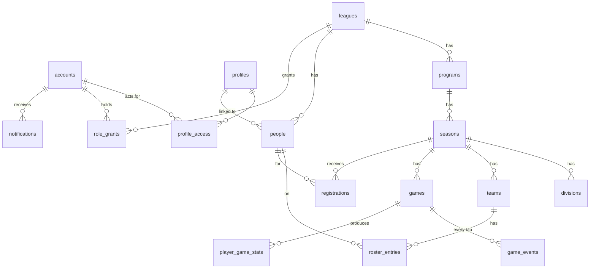

# T3 — Data model

[Spec home](../README.md) · Decisions T-40 to T-52, T-220

Every table, grouped by area, with its important columns and the rules the database itself enforces. Column lists show what matters for understanding; every table also has `id`, `created_at` and `updated_at` unless noted. The earlier [v0.7 database document](../../../product/platform/engineering/02-database-and-integrity.md) goes further on some column-level detail; where names differ, the names here win.

## 1. Conventions

- **T-40: every table that holds league data has a `league_id` column**, and every link between two such tables includes it. A roster entry cannot point at a team in another league because the database refuses the row, whatever the code does.
- **T-41: IDs are UUIDs** (version 7, which sort by creation time). Addresses use short names (`farajleague`, `jaysh`) where a human reads them and IDs elsewhere.
- **T-42: times are stored in UTC**; each league has a time zone used for display, for reminder timing and for quiet hours. Dates without a time (a birthday) are stored as dates.
- **T-43: money is whole cents plus a currency code.** Never a decimal number.
- **T-44: real columns for anything we search, sort, join or constrain; JSON only for self-contained documents.** A page layout, a form definition, a set of form answers, a game's engine state and a season's rules are JSON, each with a written schema and a version number. Scores, dates, names, statuses and links are columns.
- **T-45: things that the bin can restore have `deleted_at`.** Things that are history (game events, accepted agreements, published site versions, the activity log) are never edited or deleted, only added to.
- **T-46: rows that two people might edit at once have a `version` number.** A save states the version it started from; if it has moved, the save is refused and the user sees the latest (A-8).

## 2. The core at a glance

## 3. Accounts and people

The split between these tables is what makes "one account, many leagues", "admin adds people by hand" and "parents manage children" all work (U-11, R-3, R-7).

| Table            | What a row is                                              | Key columns                                                                                                                                                                  |
| ---------------- | ---------------------------------------------------------- | ---------------------------------------------------------------------------------------------------------------------------------------------------------------------------- |
| `accounts`       | A sign-in. One per email. Not tied to any league.          | `email`, `display_name`, `phone`, `last_seen_at`                                                                                                                             |
| `profiles`       | A human being an account can act for: yourself, or a child | `first_name`, `last_name`, `birth_date`                                                                                                                                      |
| `profile_access` | Which account may act for which profile                    | `account_id`, `profile_id`, `relation` (self or guardian)                                                                                                                    |
| `people`         | A person **as one league knows them**                      | `league_id`, `profile_id` (empty until linked), `first_name`, `last_name`, `public_name`, `contact_email`, `birth_date`, `is_minor`, `visibility`, `photo`, `merged_into_id` |
| `follows`        | An account following a team                                | `account_id`, `league_id`, `team_id`                                                                                                                                         |

A person added by hand is a `people` row with an empty `profile_id`. Claiming or registering fills it in. Statistics and rosters point at `people`, so nothing moves when the link is made.

A profile is linked to at most one person in a league (while not in the bin), and a person is merged only into another person of the same league. `visibility` is the person's own request for public pages: `none`, `initials` or `removed` (R-15, R-17). Erasure (T-52) empties the name, contact details, birth date and link in place, so the names may be empty; `is_minor` is empty when the league does not know. `photo` waits for the `assets` table (section 10). Detail: [decision record 022](../../../architecture/decisions/022-people-teams-and-rosters.md) (T-234).

## 4. Leagues and structure

| Table                 | What a row is                        | Key columns                                                                                                                                                                                                                                                                                      |
| --------------------- | ------------------------------------ | ------------------------------------------------------------------------------------------------------------------------------------------------------------------------------------------------------------------------------------------------------------------------------------------------ |
| `leagues`             | A customer and its site              | `slug` (unique across the platform), `name`, `status` (draft, live, archived, suspended), `time_zone`, `audience` (adult, youth, mixed), `contact_email`, `listed`, `owner_account_id`, `agreement` (JSON: the price, term and limits agreed with us), `wording` (JSON: the league's own labels) |
| `league_slug_history` | A former short name still forwarding | `old_slug`, `league_id`, `expires_at`                                                                                                                                                                                                                                                            |
| `league_features`     | An optional feature switched on      | `league_id`, `feature_key`, `enabled`, `config` (JSON)                                                                                                                                                                                                                                           |
| `programs`            | A sport for a group                  | `league_id`, `slug`, `name`, `sport_key`, `is_default`                                                                                                                                                                                                                                           |
| `seasons`             | One running of a program             | `program_id`, `slug`, `name`, `starts_on`, `ends_on`, `status`, `is_current`, `rules` (JSON, versioned), `stat_keys`, `logo`, `unique_jerseys`                                                                                                                                                   |
| `divisions`           | A group of teams sharing standings   | `season_id`, `name`, `color`, `sort`, `parent_division_id`                                                                                                                                                                                                                                       |
| `clubs`               | A member organization (a school)     | `league_id`, `slug`, `name`, `logo`, `colors`                                                                                                                                                                                                                                                    |
| `venues`, `courts`    | Where games are played               | `name`, `address`, `map_link`; a court belongs to a venue and has a `sort`                                                                                                                                                                                                                       |
| `setting_values`      | A value an admin set for one setting | `league_id`, `level` (league, program, season), `program_id` or `season_id`, `key`, `value` (JSON: `{"version", "value"}`)                                                                                                                                                                       |

Every league gets one program with `is_default` set when it is created. Single-program leagues never see it (U-3, U-12).

`seasons.logo` is not built yet: it will link to an uploaded image, so it waits for the `assets` table (section 10). `seasons.unique_jerseys` is worked out from the rules document (`rosters.uniqueJerseys`), so the switch has one home and a real column the database enforces (T-44, record 022).

A division's parent is in the same season, and a division is never its own ancestor. A court stays at its venue. Names are unique where people pick by name: a division among its siblings in its season, a venue in its league, a court at its venue, while not in the bin. Divisions, venues and courts go to the bin (`deleted_at`).

**Setting values** (T5 section 6, T-231, [decision record 019](../../../architecture/decisions/019-where-setting-values-are-stored.md)). Settings are declared in code; `setting_values` holds only the values an admin has set, one per key at each place (the league, one program or one season). "Not set" is no row, so clearing a value removes it and the lookup falls back to the next level. `value` is a small versioned document whose version is the setting's declared format; the declaration's schema checks what is inside.

## 5. Access

| Table                | What a row is                                | Key columns                                                                                                                      |
| -------------------- | -------------------------------------------- | -------------------------------------------------------------------------------------------------------------------------------- |
| `role_grants`        | "This account has this role here"            | `league_id`, `account_id`, `role`, `scope_type` (league, program, club, team), `scope_id`, `granted_by_account_id`, `revoked_at` |
| `invitations`        | A pending invitation                         | `league_id`, `email`, `role`, scope, `token_hash`, `expires_at`, `accepted_at`                                                   |
| `activity_log`       | Who changed what (A-6)                       | `league_id`, `actor_account_id`, `action`, `target_type`, `target_id`, `summary`, `details` (JSON), `at`                         |
| `support_access_log` | Our staff opening a league (section 8 of P2) | `league_id`, `staff_account_id`, `reason`, `started_at`, `ended_at`                                                              |

A grant's account, role and scope, and an invitation's email, role and scope, never change once the row exists: a different role is a new grant. A program or team scope points at a program or team of the same league; club scopes are refused until the `clubs` table exists. An activity entry's `action` is the command's name and its `summary` a message key (T-226); `details` holds ids and fixed words only. A support visit starts when its row is written and lasts at most an hour (T-77); while it runs it can be ended early, and once over it never changes.

## 6. Registration

| Table                              | What a row is                                  | Key columns                                                                                                                                                                                                               |
| ---------------------------------- | ---------------------------------------------- | ------------------------------------------------------------------------------------------------------------------------------------------------------------------------------------------------------------------------- |
| `registration_forms`               | A season's registration setup                  | `season_id`, `mode`, `opens_at`, `closes_at`, `capacity`, `approval`, `access`, `status`                                                                                                                                  |
| `registration_form_versions`       | The questions as they stood at a point in time | `form_id`, `version`, `definition` (JSON)                                                                                                                                                                                 |
| `agreements`, `agreement_versions` | A waiver and each wording of it                | `title`; `body`, `version`, `published_at`                                                                                                                                                                                |
| `registrations`                    | One sign-up                                    | `season_id`, `person_id`, `form_version_id`, `submitted_by_account_id`, `kind` (individual, captain, team player), `team_id`, `status`, `waitlist_position`, `answers` (JSON), `submitted_at`, `decided_by`, `decided_at` |
| `agreement_acceptances`            | Proof someone agreed                           | `registration_id`, `agreement_version_id`, `typed_name`, `accepted_by_account_id`, `accepted_at`, `method` (accepted online, or collected by the league), `recorded_by_account_id`                                        |
| `team_invites`                     | A captain's invite link                        | `team_id`, `token_hash`, `expires_at`                                                                                                                                                                                     |

A registration points at the exact form version and agreement version it was made against, so later edits never rewrite what someone answered or accepted.

Stage 5 adds `payment_accounts` (a league's connected payment account), `orders`, `payments`, `refunds` and `discount_codes`.

## 7. Teams

| Table            | What a row is        | Key columns                                                                                                                                                                                      |
| ---------------- | -------------------- | ------------------------------------------------------------------------------------------------------------------------------------------------------------------------------------------------ |
| `teams`          | A team in one season | `season_id`, `division_id`, `club_id`, `slug`, `name`, `color`, `logo`, `stats_visibility` (everyone, league members, team, or staff), `lineage_id` (ties the same team together across seasons) |
| `roster_entries` | A person on a team   | `team_id`, `person_id`, `jersey_number`, `role` (player, captain, coach), `joined_on`, `left_on`, `sort`                                                                                         |
| `drafts`         | A draft              | `season_id`, `status`, `order_type`, `seconds_per_pick`, `team_order`                                                                                                                            |
| `draft_picks`    | One pick             | `draft_id`, `pick_number`, `team_id`, `person_id`, `undone_at`                                                                                                                                   |

A team's division is optional and of the same season. Its short name and its name are unique in its season while not in the bin; a lineage has at most one team in a season, and a team never moves to another season. `stats_visibility` takes S-22's four levels (`everyone`, `members`, `team`, `staff`) and has no default: the league's setting gives a new team its starting level. `logo` waits for the `assets` table and `club_id` for the `clubs` table.

A roster entry's team and person are the same league's, and never change: moving a player is leaving one team and joining another. A person is on a team once at a time. Leaving sets `left_on` and keeps the entry (R-17, T-52); roster entries are not binned. A jersey number is 0 to 99 or 00, or empty. While the season's `unique_jerseys` is on, no two people still on a team (no `left_on`) wear the same number, and the switch cannot be turned on while a team already has a number worn twice. Detail: record 022.

## 8. Schedule and games

| Table                | What a row is                                 | Key columns                                                                                                                                                                                                                                                                                                                                           |
| -------------------- | --------------------------------------------- | ----------------------------------------------------------------------------------------------------------------------------------------------------------------------------------------------------------------------------------------------------------------------------------------------------------------------------------------------------- |
| `rounds`             | A week or round                               | `season_id`, `number`, `label`, `date`                                                                                                                                                                                                                                                                                                                |
| `stages`             | Regular season or a bracket                   | `season_id`, `type`, `name`, `config` (JSON)                                                                                                                                                                                                                                                                                                          |
| `games`              | A published game                              | `season_id`, `division_id`, `round_id`, `stage_id`, `game_number`, `home_team_id`, `away_team_id`, `starts_at`, `venue_id`, `court_id`, `status` (scheduled, live, final, postponed, cancelled, forfeit), `capture_mode` (final, box, live), `home_score`, `away_score`, `winner_team_id`, `format` (JSON), `finalized_at`, `external_ref`, `version` |
| `schedule_drafts`    | Unpublished schedule edits                    | `season_id`, `changes` (JSON), `based_on_revision`                                                                                                                                                                                                                                                                                                    |
| `schedule_revisions` | Each publication of the schedule              | `season_id`, `number`, `published_by`, `published_at`, `summary` (JSON)                                                                                                                                                                                                                                                                               |
| `bracket_slots`      | A position in a bracket                       | `stage_id`, `round`, `position`, `game_id`, where each side comes from                                                                                                                                                                                                                                                                                |
| `game_assignments`   | A scorekeeper assigned to a game              | `game_id`, `account_id`                                                                                                                                                                                                                                                                                                                               |
| `scoring_sessions`   | The one device currently scoring a game (S-5) | `game_id`, `account_id`, `device_id`, `held_until`                                                                                                                                                                                                                                                                                                    |
| `game_events`        | **Every tap in the tracker.** Never edited.   | `game_id`, `seq`, `command_id`, `type`, `payload` (JSON), `tapped_at`, `account_id`                                                                                                                                                                                                                                                                   |
| `game_states`        | The engine's latest state for a game          | `game_id`, `seq`, `state` (JSON)                                                                                                                                                                                                                                                                                                                      |
| `player_game_stats`  | One player's line in one game                 | `game_id`, `team_id`, `person_id`, `played`, `seconds_played`, `stats` (JSON keyed by stat)                                                                                                                                                                                                                                                           |
| `game_corrections`   | A reopening, with reason                      | `game_id`, `account_id`, `reason`, `before`, `after`, `at`                                                                                                                                                                                                                                                                                            |

The current live tracker already stores exactly this: a command log, the latest state, the score and the box score lines, saved together. The table shapes carry over.

## 9. Calculated tables

These are never edited by hand (A-12, S-9). They are rebuilt from games whenever a result changes, inside the same transaction, and can be rebuilt from scratch at any time.

| Table                   | What it holds                                                                                                                 |
| ----------------------- | ----------------------------------------------------------------------------------------------------------------------------- |
| `standings_rows`        | Per team per division: rank, seed, wins, losses, ties, points for and against, streak, and which tiebreaker decided its place |
| `standings_adjustments` | Manual adjustments with reasons (S-10). This one is entered by an admin and feeds the calculation.                            |
| `season_player_totals`  | Per player per season: games played, minutes, each stat's total                                                               |

**How standings are worked out** (technical reading of P7 §1 and §6, built in `packages/sports/src/standings`, step 2.7). Final and forfeit games count; a forfeit is scored at the season's forfeit score, and adds no points for, against or difference when the season says it does not count in point difference. A final game with level scores counts as a tie even when ties are off, and is reported to the admin. Teams level on win percentage (or points) go through the admin's tiebreakers in order. When a tiebreaker splits a group but leaves some teams still level, those teams start the list again among themselves only. Head-to-head uses the table's measure over games between the level teams (points per game in a points table) and is passed over unless every one of them has played at least one of the others. A coin flip uses the latest flip the admin recorded that covers every level team. Teams that no tiebreaker separates share a rank and take seeds in id order until the admin records a flip. Adjustments (S-10) change wins, losses, ties and standings points, never games played, points for and against, the streak or head-to-head; one that cannot apply is left out and reported. Games, teams and adjustments that cannot be read are left out and reported. Where the coin flips the admin records are stored is not yet settled.

## 10. Site and content

| Table                              | What a row is                                        | Key columns                                                                                                    |
| ---------------------------------- | ---------------------------------------------------- | -------------------------------------------------------------------------------------------------------------- |
| `sites`                            | A league's site in its draft state                   | `league_id`, `design_draft` (JSON), `menu_draft` (JSON), `published_release_id`                                |
| `pages`                            | A page in its draft state                            | `league_id`, `slug`, `title`, `kind` (standard or custom), `program_id`, `draft` (JSON: the stack of sections) |
| `site_releases`                    | A published version of the whole site. Never edited. | `league_id`, `number`, `design`, `menu`, `pages` (JSON), `published_by`, `published_at`                        |
| `assets`                           | An uploaded image                                    | `league_id`, `path`, `width`, `height`, `alt_text`, `bytes`                                                    |
| `news_posts`                       | A news post                                          | `slug`, `title`, `body` (JSON), `status`, `pinned`, `published_at`                                             |
| `award_types`                      | An award the league gives                            | `name`, `cadence` (per round or per season), `stat_key`, `sort`                                                |
| `awards`                           | An award given                                       | `season_id`, `round_id`, `award_type_id`, `person_id`, `team_id`, `note`                                       |
| `sponsors`                         | A sponsor in a season                                | `season_id`, `name`, `tier`, `logo`, `link`, `division_id`, `team_id`, `sort`                                  |
| `media_collections`, `media_items` | A named collection and a video link in it            | `name`; `season_id`, `round_id`, `title`, `link`                                                               |

The public site is always drawn from the latest `site_releases` row, never from drafts (A-9, C-3).

## 11. Notifications and background work

| Table                | What a row is                   | Key columns                                                                                  |
| -------------------- | ------------------------------- | -------------------------------------------------------------------------------------------- |
| `notifications`      | An inbox item                   | `account_id`, `league_id`, `type`, `title`, `body`, `link`, `read_at`, `dedupe_key` (unique) |
| `notification_prefs` | A person's choice               | `account_id`, `league_id`, `type`, `channel`, `enabled`                                      |
| `announcements`      | A message from a league         | `league_id`, `audience` (JSON), `subject`, `body`, `essential`, `send_at`, `sent_at`         |
| `email_deliveries`   | One email and what became of it | `league_id`, `to_email`, `template`, `status` (queued, sent, delivered, bounced, complained) |
| `email_suppressions` | An address we must not email    | `email`, `reason`                                                                            |
| `imports`            | A spreadsheet import            | `league_id`, `kind`, `status`, `report` (JSON), what it created (so it can be undone)        |
| `command_receipts`   | Commands already carried out    | `league_id`, `account_id`, `command_id`, `command`, `result`                                 |
| `jobs`               | A job a change left (T-224)     | `league_id`, `type`, `ids` (JSON, ids only, T-131), `dedupe_key`, `state`, `run_after`       |
| pg-boss's tables     | Jobs handed over to run         | In their own `pgboss` schema, which the app's role cannot use (record 012)                   |

`dedupe_key` is what guarantees "nothing is ever sent twice" (N-8): a recap for game G to account A has one possible key, and the database refuses a second.

A command receipt is unique by league, account and command id together, and is looked up by all three, so one account can never be answered with another account's result. Commands the system runs have no account and share one key.

### Group chats (N-15, N-16; from stage 4)

| Table                  | What a row is                | Key columns                                                                                                                 |
| ---------------------- | ---------------------------- | --------------------------------------------------------------------------------------------------------------------------- |
| `conversations`        | A chat                       | `league_id`, `scope_type` (league, division, team, custom), `scope_id`, `name`, `mode` (announcements or open), `closed_at` |
| `conversation_members` | An account in a chat         | `conversation_id`, `account_id`, `can_post`, `muted_until`, `last_read_message_id`                                          |
| `messages`             | One message. Text only.      | `conversation_id`, `author_account_id`, `body`, `sent_at`, `removed_at`, `removed_by`                                       |
| `message_reports`      | A member reporting a message | `message_id`, `reporter_account_id`, `reason`, `handled_at`                                                                 |

Members of team and division chats are worked out from rosters, so they never drift from the teams.

## 12. Rules the database enforces by itself

**T-47:** these hold even if the application has a bug.

- A league short name is unique across live leagues and unexpired history.
- Only one season per program is marked current.
- A person has at most one active registration per season.
- A game's two teams are different and in the same season.
- Within a game, each `command_id` and each `seq` appears once (a tap cannot be saved twice).
- Jersey numbers are unique within a team where the season's rules require it.
- A final game has both scores; a scheduled game has none.
- Capacity: taking a place locks the form row first, so two simultaneous sign-ups cannot both take the last place.
- Row-level security on every league table, as the second fence ([T4](T4-tenancy-auth-security.md)).

What these rules do not cover yet:

- **TRUNCATE.** The triggers that keep history unchanged run per row, and `TRUNCATE` fires no row triggers, so it would empty a history table. The app's database role must never be granted `TRUNCATE` (step 1.7); migrations are already barred from it (T-183).
- **Creation times.** `created_at`, and `at` in the activity log, default to the current time but the caller can still set them. Commands must leave them to the database; making the database refuse a caller's value is open.

## 13. Changing the schema

- **T-48:** the schema changes only through numbered SQL files in `supabase/migrations/`, reviewed like code and applied automatically on release. Nobody edits the production database by hand.
- **T-49:** changes are made in two steps when needed: first add the new thing while the old still works, release, then remove the old. This allows releasing without downtime.
- **T-50:** JSON documents carry a version number, and reading an old version upgrades it in code, so a format change never requires rewriting every league's pages at once.

## 14. Keeping and deleting

- **T-51:** the bin holds soft-deleted rows for 30 days, then a nightly job removes them for good.
- **T-52:** a player who leaves a team or the league keeps their history: the roster entry gets a `left_on` date and every record stays as it was. Removal is a separate, explicit request (R-17). Then their `people` row loses its name, contact details and link, and their statistics rows remain attached to the now-nameless record. When an account is deleted, its `accounts`, `profiles`, preferences and inbox are erased, and each league's `people` row is treated the same way. Accepted agreements and payment records are kept for the period the law requires, then removed.
- **T-220: history keeps ids, so erasure and purging never rewrite it.** History tables (`activity_log`, `command_receipts`, `support_access_log`, and later ones) link to `accounts` and `leagues` and are never changed. So erasing an account overwrites its `accounts` row in place: the row and its id stay, the email becomes a placeholder and every other personal detail is emptied; history keeps only the id. History rows therefore name accounts and people by id, never by copying their names or emails. A league purged from the bin (T-51) loses its history through one function, `purge_league_history`, which only the role that owns the tables can run, only for a league in the bin for 30 days. The rest of the purge is the nightly job's work. Detail: [decision record 007](../../../architecture/decisions/007-history-erasure-and-purge.md).
